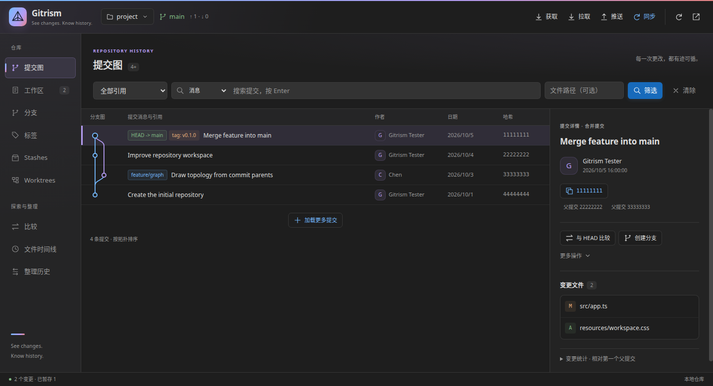
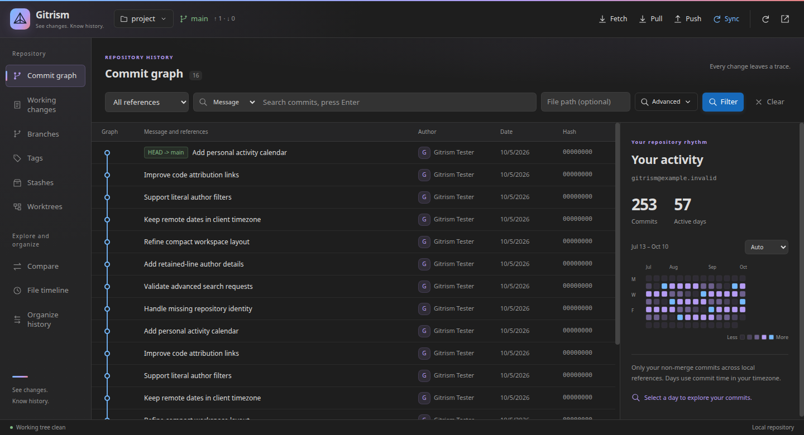
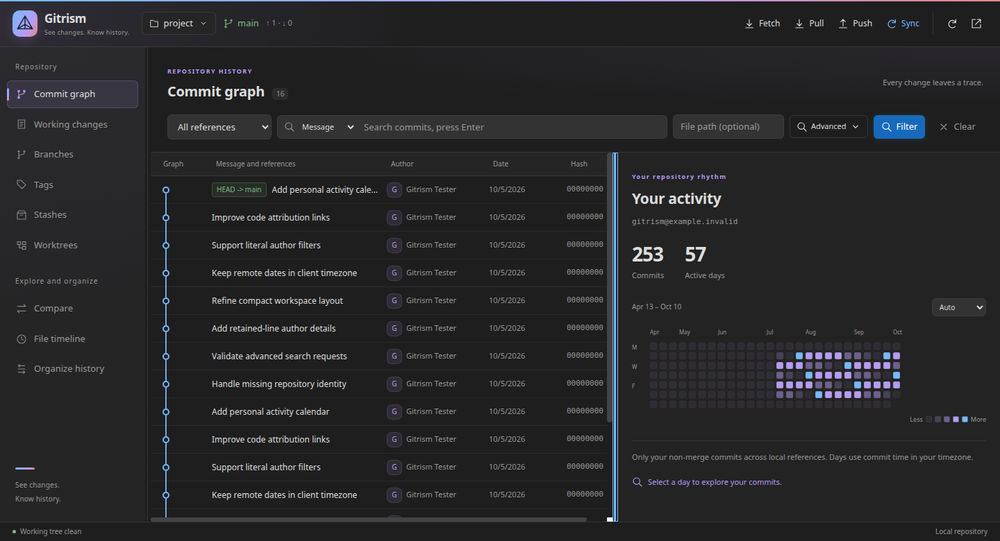

# Gitrism

**See changes. Know history.**

A private, local-first Git workspace for Visual Studio Code, Cursor, and Neovim. Gitrism helps you inspect history, review changes, manage branches and worktrees, and keep everyday Git work in one place.

No account, subscription, telemetry, cloud backend, external avatars, or AI service is required.

## Preview







## Features

- Commit graph with parent topology, branches, merges, tags, and incremental loading.
- Advanced search by message, author, hash, reference, file, date, merge mode, first parent, or personal email.
- Commit details, rename-aware file lists, native VS Code diffs, comparisons, file timelines, blame, and line history.
- Working changes with directory tree or flat list views, collapsible folders, and staged, unstaged, untracked, conflict, and stash workflows.
- Branches, tags, worktrees, fetch, pull, push, sync, cherry-pick, revert, merge, and rebase controls.
- Interactive history cleanup with reorder, squash, fixup, drop, backup branches, and conflict recovery.
- Current-line attribution with author, date, commit, and message; optional function/class CodeLens and author breakdowns.
- Personal activity calendar based only on the current repository's configured `user.email`.
- Draggable navigation and history/detail panes with keyboard controls and saved layout preferences.
- English, Simplified Chinese, and Traditional Chinese UI; Git 2.25.1+ compatibility.

Gitrism uses local Git data. Personal activity excludes collaborators, merge commits, stash/notes commits, and duplicate references. It does not represent GitHub issues, pull requests, or other server activity. CodeLens describes current retained lines and skips unsaved documents.

## Install

Download a `.vsix` from [GitHub Releases](https://github.com/SunboTax/Gitrism/releases), then choose **Extensions: Install from VSIX...** in VS Code or Cursor. Both editors use the same package.

For Remote SSH, install Gitrism on the remote Extension Host and reload the window. See the [Cursor guide](docs/cursor.md) for local/SSH setup and verified compatibility.

## Neovim

A native Neovim 0.10+ commit graph keeps history, patches, blame, and author attribution in the terminal. It needs only Neovim and Git; the browser workspace is optional. See the [setup guide](docs/neovim.md).

See the [0.6.1 release notes](docs/releases/v0.6.1.md) for changes and upgrade notes.

## Quick start

1. Open a Git repository.
2. Open the **Gitrism** bottom panel or run **Gitrism: Open Commit Graph**.
3. Select a commit to inspect details and open native diffs.
4. Use **Working changes** to stage files and commit staged content.
5. Drag the visible dividers to adjust navigation, history, details, or graph height. Double-click a divider to restore its default.

Current-line attribution is enabled by default. Use **Gitrism: Toggle Inline Blame** to hide it, or **Gitrism: Toggle Function Attribution** for optional function/class CodeLens (also requires `editor.codeLens`). Use **Network proxy** in the toolbar for HTTP/SOCKS5 settings; see the [proxy guide](docs/network-proxy.md). Other preferences are available under `gitrism.*` settings.

## Development

Requirements: VS Code 1.85+, Git 2.25.1+, and Node.js 22+.

```bash
npm ci
npm run check
npm test
npm run package
```

See [feature scope](docs/feature-scope.md) for detailed behavior and limits, [localization notes](docs/localization.md) for translation maintenance, and the [preliminary intellectual property review](docs/ip-review-2026-10-05.md) for the project's independent implementation checks.

## Privacy and independence

Git operations run locally. Git remote access occurs only when you request fetch, pull, push, or sync, using your configured Git remotes and credentials.

Gitrism is independently implemented and contains no GitLens code or assets. It does not modify GitLens or bypass subscription checks. Gitrism is not affiliated with GitKraken or other Git extensions.

## Community

社区友链:[LNUXDO](https://linux.do/)--新一代极客与开源探索技术社区，真诚、友善、团结、专业。

## License

[MIT](LICENSE).
