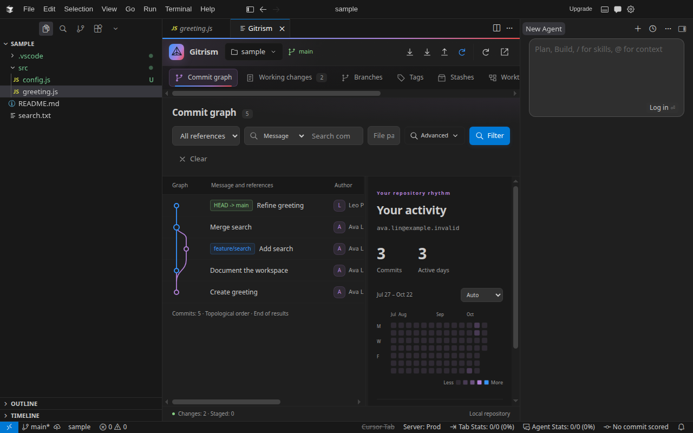
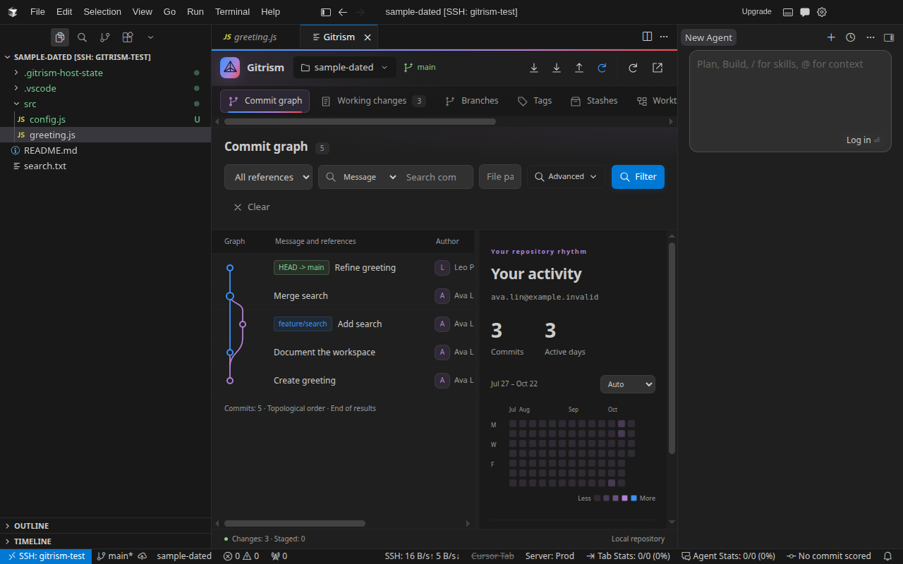

# Cursor

Gitrism uses Cursor's VS Code extension APIs. Install the same VSIX used by VS Code; no separate adapter, account, or Gitrism background service is required.

## Local installation

1. Download `gitrism-0.6.0.vsix` from [GitHub Releases](https://github.com/SunboTax/Gitrism/releases), or build it with `npm ci && npm run package`.
2. In Cursor, run **Extensions: Install from VSIX...**, select the file, and reload the window if prompted.
3. Open a Git repository, then run **Gitrism: Open Commit Graph** or **Gitrism: Open Panel**.

The Cursor CLI also supports `cursor --install-extension /absolute/path/gitrism-0.6.0.vsix`.

Current-line attribution follows the caret by default. Function/class CodeLens is optional: run **Gitrism: Toggle Function Attribution** and enable `editor.codeLens`. Function ranges come from the language's symbol provider; unsaved documents skip attribution.

## Remote SSH

1. Install Cursor's **Remote - SSH** extension and connect to the host.
2. Open the repository in that SSH window. Git 2.25.1+ must be available on the remote host's `PATH`.
3. Run **Extensions: Install from VSIX...** in the connected window. Check that Gitrism is installed under **SSH: your-host**. If the extension is already installed locally, use **Install in SSH: your-host** in its extension entry.
4. Reload if prompted, then open the graph. **Developer: Show Running Extensions** should show Gitrism on the remote host.

Git commands and attribution run beside the repository on the remote host; the webview and native diff appear in your Cursor window. Gitrism does not need a forwarded HTTP port. Fetch, pull, push, and sync use the remote host's Git credentials and configuration.

If a repository is missing, confirm the remote folder contains a Git repository and run `git status` in the remote terminal. If commands are missing, check the remote installation and **Output → Log (Remote Extension Host)**. An older Git reporting `unknown switch 'z'` can be handled by Gitrism's Git 2.25.1 fallback; update an old Gitrism installation before changing the system Git.

## Verified compatibility

Gitrism 0.6.0 was tested in the official **Cursor 3.26.16** Linux x64 build (VS Code API **1.128.0**), locally and over a real SSH connection to an isolated Linux host on the same machine, using **Remote - SSH 1.1.16**. The probe confirmed `remoteName: ssh-remote` and execution in the workspace extension host. This checks SSH transport and host placement; it does not measure network latency or validate every remote operating system.

Both environments passed packaged VSIX activation, public commands, a real branch/merge graph, keyboard navigation, dark/light and both high contrast themes, native revision diffs, optional function CodeLens with two authors, current-line attribution, and the bottom panel. Gitrism adds no default global shortcuts; graph navigation uses the focused webview's arrow keys.





These results apply to the tested build. Windows, macOS, WSL, containers, other Cursor versions, and Cursor AI/agent integrations were not part of this acceptance run. The existing VS Code API minimum remains 1.85; it is not a guarantee for every Cursor build.

## Repeat the host checks

The Linux host test installs the packaged VSIX into a temporary profile and extension directory, creates a sample repository with fictional authors, and drives the actual Cursor UI through Chromium's debugging protocol. It needs Node.js 22+, Git, Xvfb, and an official Cursor installation. It does not use your editor settings or repositories.

```bash
npm run package
# Use the Electron executable, rather than the bin/cursor shell wrapper.
GITRISM_CURSOR_EXECUTABLE=/path/to/cursor/cursor npm run test:cursor
```

For a deb installation, the executable is typically `/usr/share/cursor/cursor`; its CLI is `/usr/share/cursor/bin/cursor`. Set `GITRISM_CURSOR_CLI` if the layout differs. On test machines where Electron sandboxing is unavailable, set `GITRISM_CURSOR_NO_SANDBOX=1` for this isolated run. `GITRISM_VSIX` selects another package; its version must match `package.json`. Screenshots, the host report, and runtime logs are saved under `output/cursor-*` or `GITRISM_HOST_OUTPUT`. The driver removes its temporary profile and sample repository when it finishes.

The automated command covers the local host. For SSH acceptance, install the same VSIX remotely and run the [host probe](https://github.com/SunboTax/Gitrism/blob/main/test/editorHost/README.md) through Cursor's remote test flags. Keep logs private: editor and SSH logs can contain connection credentials.
