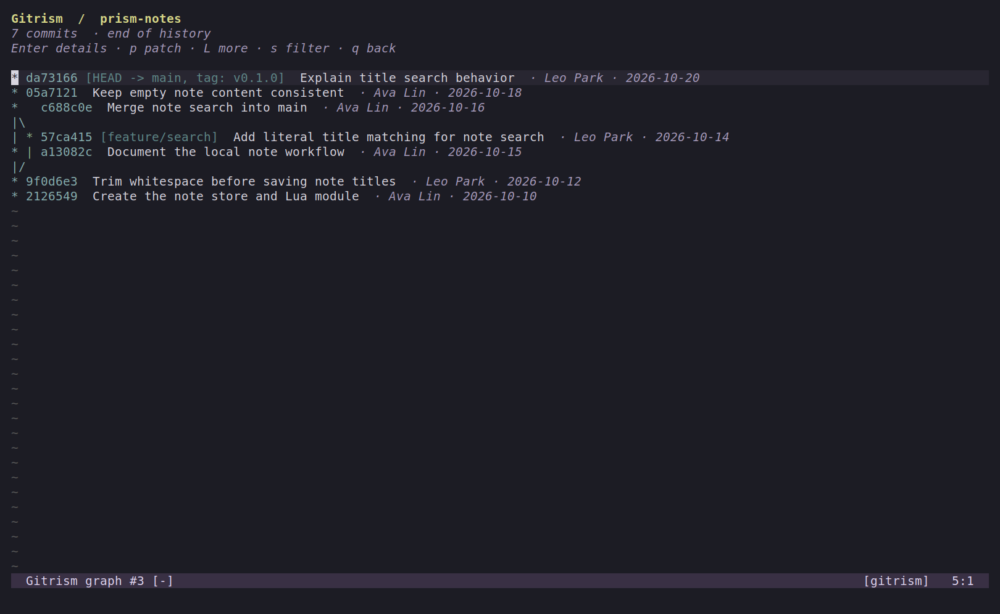
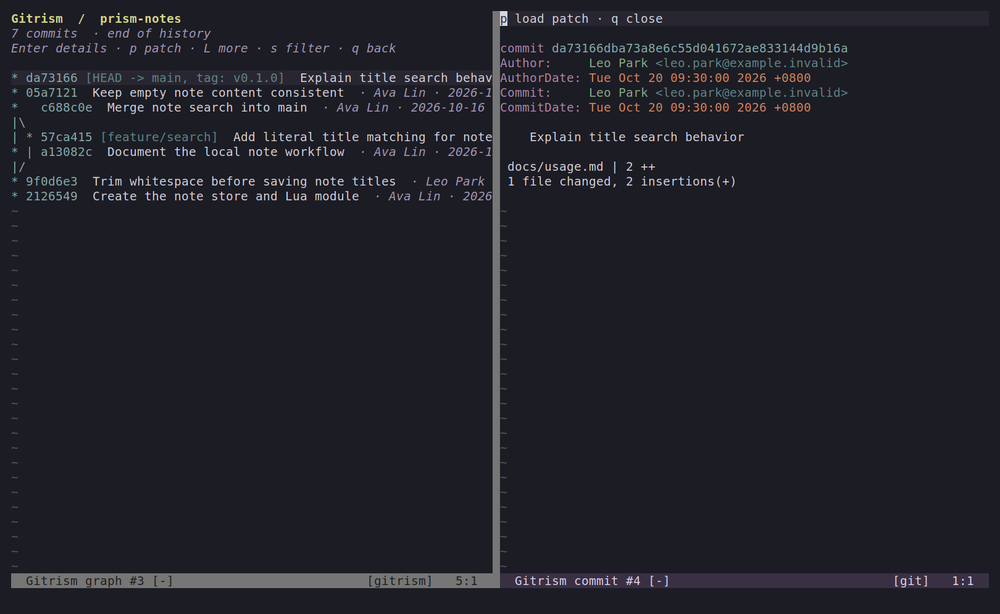
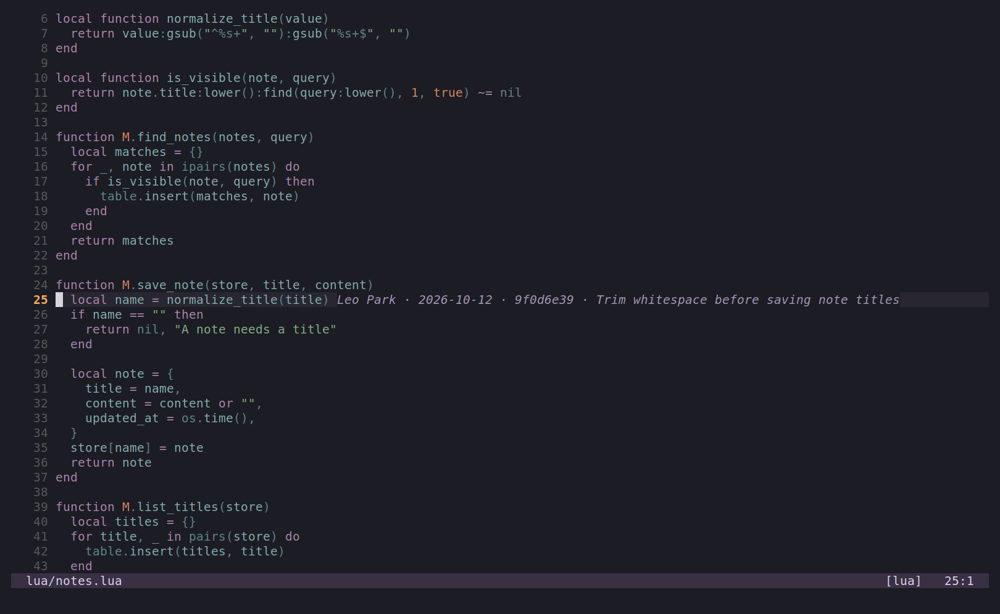
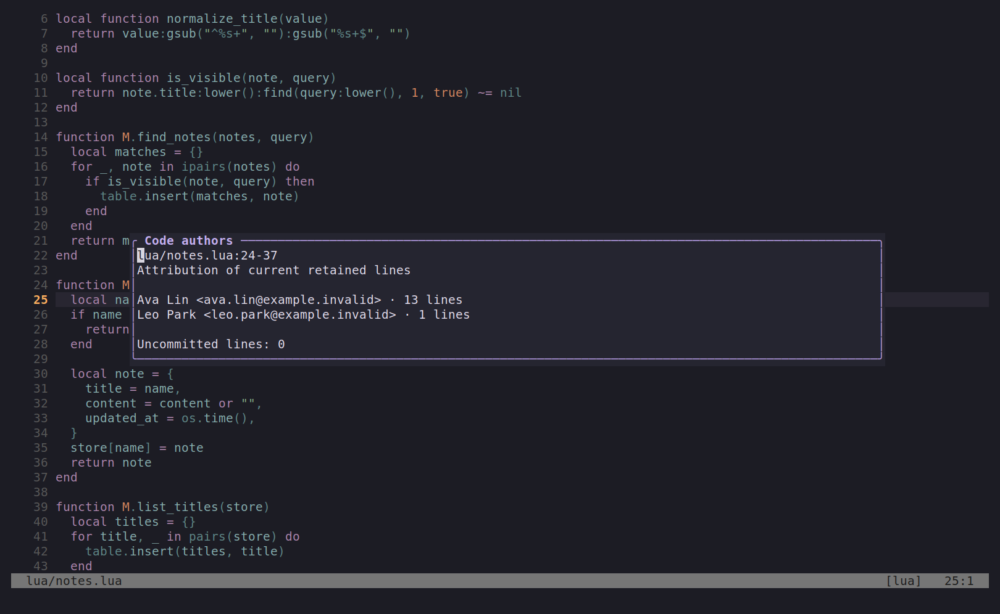

# Neovim

Gitrism runs inside Neovim: a native commit graph, on-demand commit details and patches, file/line history, and author attribution. The default commands need **Neovim 0.10+ and Git 2.25.1+**. No Node.js, build step, browser, or background server is required.

## Preview

Real Neovim 0.10.4 captures using a sample repository with fictional contributors. Colors and fonts follow the editor configuration.

Native commit graph (`:Gitrism`):



On-demand commit details (`Enter`):



Current-line attribution (enabled by default):



Selected-range authors (`:24,37GitrismAuthors`):



## Install with lazy.nvim

```lua
{
  "SunboTax/Gitrism",
  cmd = {
    "Gitrism", "GitrismHistory", "GitrismCommit", "GitrismBlame",
    "GitrismToggleBlame", "GitrismAuthors", "GitrismLineHistory", "GitrismStop",
  },
  config = function(plugin)
    vim.opt.runtimepath:append(plugin.dir .. "/editors/neovim")
    require("gitrism").setup({
      inline_blame = true, -- author, date, commit and message at the cursor line
      page_size = 200,
      max_commits = 5000,
    })
  end,
}
```

Alternatively, add `/absolute/path/Gitrism/editors/neovim` to `runtimepath` and call `require("gitrism").setup()`. The native interface currently uses English labels.

## Commands

| Command | Behavior |
| --- | --- |
| `:Gitrism` | Show the repository graph in the current window, including local and remote refs |
| `:GitrismHistory` | Show the current file's history from HEAD, following renames |
| `:GitrismCommit [ref]` | Open a commit summary in a split; defaults to HEAD |
| `:GitrismBlame` | Show current-line attribution; Enter opens its commit inside Neovim |
| `:GitrismToggleBlame` | Toggle automatic current-line attribution |
| `:GitrismAuthors` | Show retained-line authors for the smallest enclosing LSP symbol, or the file |
| `:'<,'>GitrismAuthors` | Show retained-line authors for a selection |
| `:'<,'>GitrismLineHistory` | Show Git history and patches for selected lines; defaults to the current line |
| `:GitrismStop` | Cancel active Git queries and stop any optional browser services |
| `:GitrismWeb` | Explicitly launch the optional browser workspace; requires the build below |

Current-line annotations are enabled by default and follow cursor movement after a short debounce. Only the selected line is queried; moving horizontally on that line does not rerun Git. Moving to another line clears the previous annotation immediately and cancels obsolete reads. Use `inline_blame = false` to opt out, or `:GitrismToggleBlame` to toggle it.

Attribution and line history require saved buffers and support up to 5,000 lines per query. LSP symbol lookup falls back to the file after two seconds. Function and selection author statistics remain available on demand through `:GitrismAuthors`. Authors group by email; uncommitted lines appear separately. This describes current retained lines, rather than everyone who ever edited a symbol.

## Graph controls

| Key | Action |
| --- | --- |
| `j` / `k`, `/` | Normal Neovim movement and search within loaded history |
| `]c` / `[c` | Jump to the next / previous commit, skipping connector rows |
| `Enter` | Load the selected commit's metadata and file statistics |
| `p` | Load its patch; in a detail split, toggle patch / summary |
| `L` | Load another batch, preserving the selected commit |
| `s` | Filter commit messages across history, case insensitive; empty input clears |
| `r` | Refresh the graph |
| `y` | Copy the full hash to the unnamed register and, when available, clipboard |
| `q` | Close details or return from the graph to the source buffer |

The graph uses Git's own topology renderer with native syntax highlights. Details open on the right in terminals at least 120 columns wide, and below in narrower terminals. Both use ordinary Neovim windows: resize with your usual window commands or mouse settings. Long lines scroll horizontally.

Queries run asynchronously and only on demand. The graph loads 200 commits initially; `L` reruns a longer prefix to preserve continuous merge lanes, up to 5,000 commits by default. Configure `page_size` and `max_commits` (hard ceiling: 10,000). Git queries time out after 15 seconds and limit output to 4 MiB. Patches load only when requested. Closing a graph or detail buffer cancels its query and discards stale responses. There is no automatic graph polling.

Native commands work over SSH and in headless terminals without port forwarding. This iteration focuses on history and attribution; staging, commits, and history mutations remain in the VS Code and optional browser workspaces.

## Optional browser workspace

For the shared graphical management interface, install **Node.js 22+** and build the checkout:

```bash
npm ci
npm run compile
```

Then run `:GitrismWeb`. With lazy.nvim, also add `GitrismWeb` to `cmd` and optionally use `build = "npm ci && npm run compile"`. Browser settings can be passed to `setup`: `locale = "en"` (`en`, `zh-CN`, `zh-TW`), `theme = "auto"` (`auto`, `dark`, `light`), `command = { "node", "/path/to/Gitrism/bin/gitrism.cjs" }`, and `open_url = function(url) ... end`.

The browser includes graph/search, personal activity, directory tree changes, staging and commits, branches, tags, stashes, worktrees, and history operations. Each tab has independent selection and search. It refreshes periodically and after editor saves or browser operations. Browser file previews show two text versions side by side with line numbers, up to 2 MiB; they do not align or highlight changed lines. File opening returns to the attached Neovim instance; conflicts open the working file for manual resolution. Worktree opening starts another workspace. Each workspace remains bound to its original repository.

The service starts only on explicit use, binds to `127.0.0.1`, requires a per-process token, and validates host/origin. Closing Neovim or its process channel stops it. Preferences are scoped to the browser origin, which changes when a different server port is used. Opening this workspace grants that local session the same Git management operations as the extension.

Without Neovim:

```bash
node ./bin/gitrism.cjs serve --repo /path/to/repository --open
```

Optional arguments: `--port 7123`, `--locale zh-CN`, `--theme dark`. For a browser on another machine, forward the same remote port with `ssh -L 7123:127.0.0.1:7123 user@host`, run the CLI remotely with `--port 7123`, and open its full printed URL including the fragment token. This standalone route does not attach to an existing editor.

If a crashed browser service leaves `.git/gitrism-operation.lock` (in the common Git directory for linked worktrees), confirm all Gitrism mutations have stopped before removing that directory. Successful, cancelled, and failed operations normally release it automatically. Other tools use Git's own locks.
