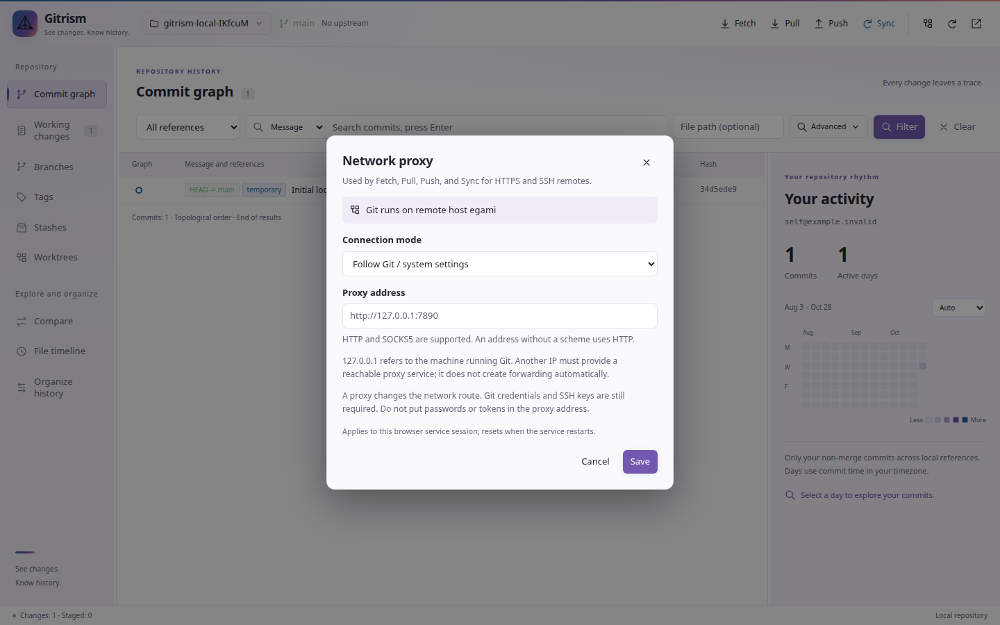

# Network proxy

Open a repository and select **Network proxy** in the Gitrism toolbar, beside Refresh. This controls Fetch, Pull, Push, and Sync for HTTPS and OpenSSH remotes.

- **Follow Git / system settings:** use existing Git, environment, and SSH settings. This is the default; an existing `gitrism.sshProxy` setting still applies to SSH in this mode.
- **Use a proxy:** enter `http://127.0.0.1:7890`, `http://192.168.1.10:7890`, or `socks5h://192.168.1.10:1080`. A bare `host:port` uses HTTP. `socks5h` resolves destination names through the proxy; `socks5` uses local DNS.
- **Direct connection:** bypass HTTP/SOCKS proxy settings and SSH ProxyCommand/ProxyJump for Gitrism's remote operations.



## Which machine does the address refer to?

The dialog shows the machine running Git. `127.0.0.1` means that machine. In a Remote SSH workspace it means the remote host, rather than your desktop. Browser workspaces use the machine running the Gitrism service.

Another IP must already run an accessible HTTP or SOCKS5 proxy on the specified port. Entering an IP does not install a proxy or establish forwarding. A proxy bound only to another machine's loopback interface cannot be reached through its LAN address.

To use a desktop proxy from an SSH host without exposing it to the LAN, you can keep a reverse tunnel open from the desktop:

```bash
ssh -N -R 127.0.0.1:17890:127.0.0.1:7890 user@remote-host
```

Then configure `http://127.0.0.1:17890` in the remote workspace, matching the desktop proxy's protocol.

## Scope and authentication

VS Code and Cursor save the choice as `gitrism.proxy` in the current workspace's settings, shared across its Gitrism views. The optional browser workspace shares the choice among clients of the same service; it resets on service restart. Local history, blame, staging, and commits do not use the proxy.

Only Gitrism's Git subprocesses receive these overrides. The extension does not change system proxies, Git configuration files, or other extensions. SSH tunnels use the editor/CLI's Node runtime and OpenSSH, with no extra `nc` dependency for the new setting. Existing SSH identity and host-key options remain in effect.

Proxy authentication, credentials embedded in proxy URLs, and HTTPS-encrypted connections to the proxy itself are not supported. HTTPS connections to Git remotes retain normal TLS certificate checks. Git credentials, PATs, SSH keys, and SSH Agent access are still required; a proxy does not resolve missing or invalid credentials.
